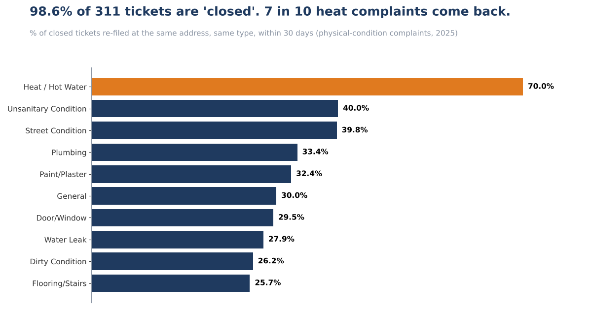
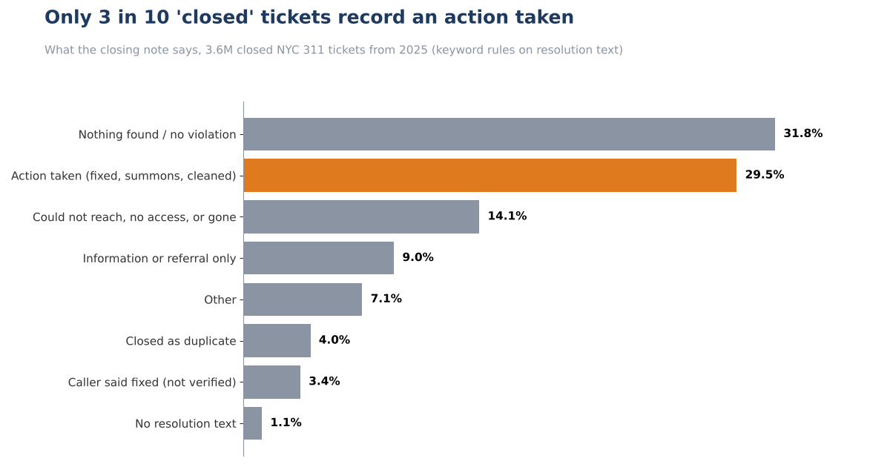
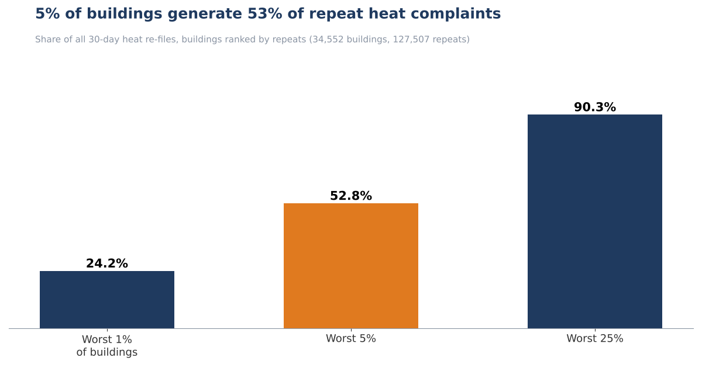
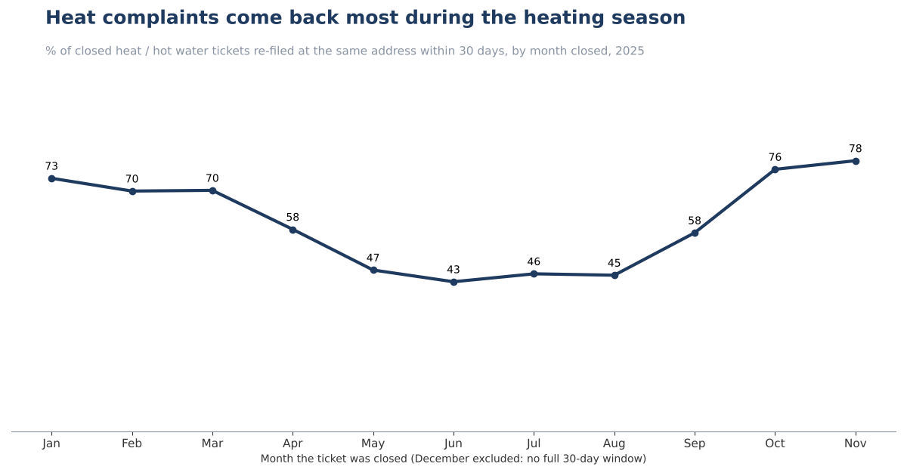

# NYC 311: "Closed" vs. Actually Fixed



**Question:** NYC 311 reports "% closed" and "time to close". Do those KPIs say anything about whether the problem was fixed, and where should the city act first?

| | |
|---|---|
| **Answer** | 98.56% of tickets are closed (median 6.6 hours), yet only **29.5%** of closed tickets record an action taken, and **70% of closed heat / hot water complaints are re-filed at the same address within 30 days**. |
| **Recommendation** | Track repeat rate next to "% closed", and treat buildings, not tickets, as the unit for heat complaints. Start with the **1,000 buildings that produce 41% of repeats**, before the heating season starts on October 1. |
| **Impact (scenario)** | The top 1,000 buildings generate about **52,500 repeat tickets a year**. Cutting their repeats by 10% to 25% means **5,300 to 13,100 fewer repeat tickets**. No cost is assumed. |
| **Data** | NYC Open Data, 311 Service Requests, 3,655,042 requests created in 2025 |
| **Tools** | SQL (DuckDB, PostgreSQL-compatible syntax), Python for the runner and charts |

---

## 1. Business problem
A 311 dashboard shows two numbers: percent closed and median time to close. Both can look excellent while the same problem keeps coming back. The question is whether "closed" is a quality signal, and if not, what to measure instead.

## 2. Data
3.65M requests across 14 columns, one year. 769 distinct free-text closing notes written by different agencies. Details in [`docs/data_quality_log.md`](docs/data_quality_log.md).

## 3. Cleaning (what changed the numbers)

| Issue | Rows | Decision |
|---|---|---|
| Closed before created | 916 | Time to close left blank |
| Missing address | 122,913 | Excluded from re-file analysis |
| Closed as "duplicate" by the agency | 144,383 | Excluded from re-file scope so they don't count as instant re-files |
| Closing notes in 769 different wordings | 3.6M closed | Mapped to 8 outcome buckets with keyword rules |
| Tickets closed in December | - | Excluded (no complete 30-day window) |

## 4. Analysis

**"Closed" does not mean "fixed".** Reading the closing note of every closed ticket:



**Does the problem come back?** A ticket is *re-filed* when a new request with the same address and the same complaint type is created within 30 days of its closure. Overall 46.5% of in-scope closed tickets are re-filed, but that figure mixes two different things:

| Complaint family | Closed tickets | Re-filed within 30 days | Reading |
|---|---|---|---|
| Behaviour (noise, parking, drugs...) | 1,670,663 | 57.7% | The behaviour recurred. Not read as failed closure |
| **Condition (heat, plumbing, leaks...)** | **1,284,203** | **32.0%** | **Suggests the physical problem was not fixed** |

Heat / hot water stands out at **70.0%**, and the result is stable across windows: 52.2% within 7 days, 61.8% within 14, 70.0% within 30.

**The closing method does not predict repeats.** Within heat complaints, re-file rates sit between 61% and 71% whether the ticket was closed after an inspection with action (69.6%), a phone check with the caller (70.5%), no finding (64.7%) or an inspector who could not get in (60.9%). Only information-only closures are higher (88.4%). A first pooled comparison suggested caller-verified closures were worse. That was a complaint-type effect and is documented as a mistake in [`docs/ai_log.md`](docs/ai_log.md).

**The repeats are concentrated.**



The worst 1,000 of 34,552 buildings account for 41.2% of all repeat heat tickets. Repeats are also seasonal:



## 5. Key insight
"% closed" and "time to close" cannot see the problem. For heat, closing a ticket almost never ends the case: 7 in 10 come back, however the ticket was closed, and a small group of buildings produces most of the repeats.

## 6. Recommendation
1. **Add a 30-day repeat rate** beside "% closed" in the 311 reporting, by complaint family. Owner: 311 data team.
2. **Manage heat complaints per building.** Any building with a second heat complaint inside 30 days becomes one escalated case with a verified-restored inspection, instead of a new ticket. Owner: HPD.
3. **Pilot on the 1,000 worst buildings** before October 1, when repeat rates reach 76% to 78%.
4. **Do not read noise or parking re-files as failed closure.** They need a different response (pattern enforcement), not a re-inspection.

## 7. Business impact (scenario, not a forecast)
The 1,000 worst buildings produce 41.2% of 127,507 repeat tickets, or about 52,500 a year. A 10% cut is about 5,300 fewer repeat tickets, and a 25% cut about 13,100. Each one is a household reporting the same problem again. A cost per ticket is not assumed here because the agency's handling costs are not in the data.

## Validation
`sql/06_tieout_tests.sql` must return PASS on every row. All seven pass, including a brute-force recomputation of the re-file flag on a 20,000-ticket sample, which matches the join-based result exactly.

## Limitations
- One year of one city. 2025 only.
- Same address is not same household. In multi-unit buildings a re-file can come from a neighbour. For heat that still signals a building-level problem, but it is not proof the original fix failed.
- "Behaviour" vs "condition" is my classification of complaint types.
- Closing-note buckets come from keyword rules and are **not validated against a hand-labelled sample**. 7.1% of closed tickets fall in "other".
- Observational. This does not show why a problem returned.
- No cost data, so the impact is expressed in tickets.

## How AI was used
See [`docs/ai_log.md`](docs/ai_log.md): what AI drafted, three corrections made during validation, and the judgement calls to challenge. No language model is applied to the data itself.

## Reproduce
```
pip install duckdb pandas matplotlib
# download the 2025 monthly CSVs from NYC Open Data (dataset erm2-nwe9) into data/ as 311_2025_01.csv ... 311_2025_12.csv
python python/run_analysis.py
python python/make_charts.py
```

## Repo map
`sql/` pipeline in run order | `python/` runner and chart code | `docs/` KPI definitions, data quality log, AI log | `images/` README visuals

*Data: NYC Open Data, 311 Service Requests from 2010 to Present. See the source page for terms of use.*
